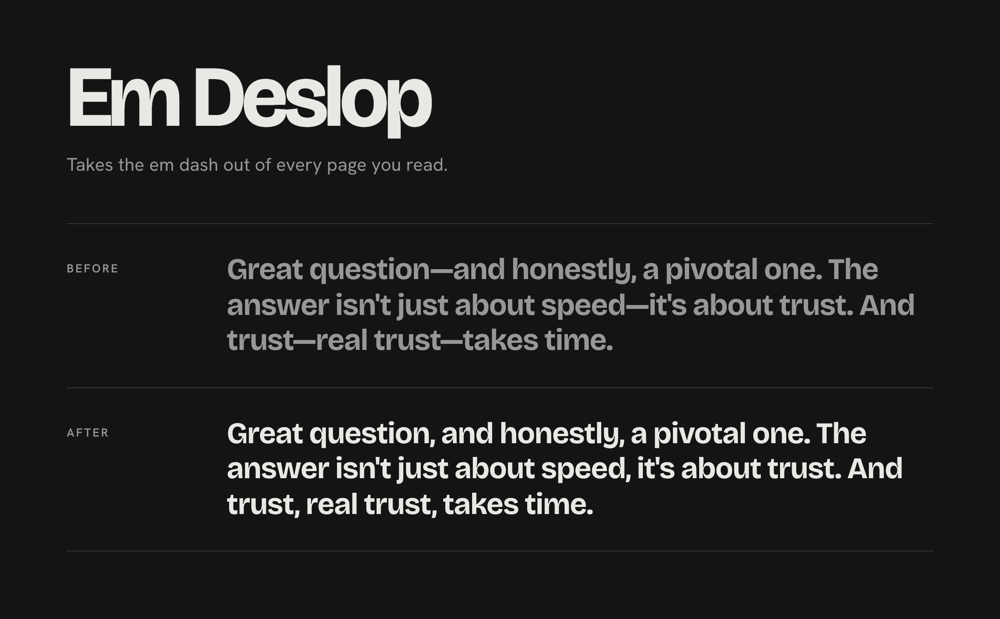
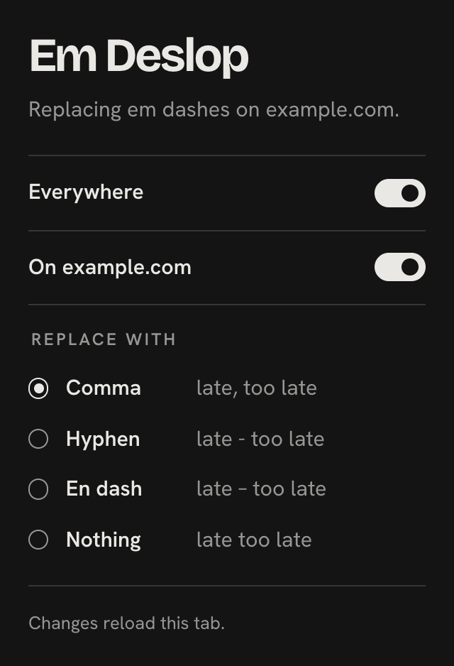

# Em Deslop



The em dash is the most obvious tell of AI writing. Em Deslop is a browser extension that replaces it on every page you read, before the page paints. Code blocks, form fields and anything you type into are left alone.

It works in Chrome and every current Chromium browser: Arc, Dia, Helium, Brave, Edge, Opera, Vivaldi. Manifest V3, plain JavaScript, no build step, no network requests, no tracking.

## Install

Em Deslop isn't on the Chrome Web Store yet. Installing from source takes a minute:

1. Clone the repo, or download it as a ZIP and unzip it:
   ```sh
   git clone https://github.com/alesmartan/em-deslop.git
   ```
2. Open your browser's extensions page: `chrome://extensions` (Brave: `brave://extensions`, Edge: `edge://extensions`, Opera: `opera://extensions`, Vivaldi: `vivaldi://extensions`).
3. Turn on **Developer mode** and leave it on. Chrome disables unpacked extensions when it's switched off.
4. Click **Load unpacked** and pick the **`extension`** folder inside the repo.
5. Pin the icon so the popup is one click away.

To update: `git pull`, then click the reload icon on the extension's card.

## What it does

Every em dash in the page's text is replaced, using the surrounding characters to pick something that reads well:

| Where the dash is | What you get |
|---|---|
| Between two words | A comma: `speed, it's about trust` |
| Between two numbers | A hyphen: `1990-2000` |
| Start of a line, like a quote attribution | Dropped: `Author Name` |
| End of a line | Dropped |
| Right before punctuation | Dropped: `wait?`, `(see below)` |
| After sentence punctuation | A space: `end. Next` |

Runs of dashes count as one, and spaces around the dash (including non-breaking and thin spaces) are absorbed. The extension also catches text that loads later: infinite scroll, single-page app navigation, live updates, iframes, and web components with open or closed shadow roots.

## The popup



- **Everywhere** turns it on or off globally.
- **On example.com** turns it off for one site, including its subdomains and the iframes it embeds.
- **Replace with** picks the style: comma (default), hyphen, en dash, or nothing.

Turning it on applies straight away. Turning it off or changing the style reloads the current tab, because rewritten text can't be put back in place. Other tabs pick up the change when you reload them.

Settings are saved with `chrome.storage.sync`, so they follow your browser account if your browser syncs.

<br clear="right">

## What it leaves alone

- Code: `pre`, `code`, `kbd`, `samp`, `var`
- Anything you type into: `input`, `textarea`, `select`, `contenteditable` editors (Gmail, Notion, docs editors), `role="textbox"`
- Code editors built from plain elements: CodeMirror, Monaco, Ace
- `script`, `style`, `noscript`, `template`
- Anything inside an element with a `data-emdash-keep` attribute, if you want to opt out on your own pages

It can't reach text drawn on a canvas (the Google Docs page body, Figma), PDFs in the browser's viewer, or pages browsers don't let extensions touch (`chrome://` pages, extension stores, the New Tab page).

Copying text from a page copies the rewritten version.

## Browser notes

| Browser | What to know |
|---|---|
| Chrome, Brave, Edge, Helium, Vivaldi | Works as installed. Edge shows a permanent "developer mode extensions" notice. It's harmless. |
| Opera | Blocks extensions on Google and Bing results by default. Tick **Allow access to search page results** on the extension's card. |
| Arc | No toolbar. Pin the extension to see it in the URL bar, or press Command-E. |
| Dia | Works like Chrome. Extension support is newer there, so report anything odd. |
| Any | Private windows: turn on **Allow in Incognito** (Brave: **Allow in Private**) on the extension's details page. |

The full comparison, with sources, is in [docs/chromium-browsers.md](docs/chromium-browsers.md).

## Privacy and permissions

Em Deslop makes no network requests and collects nothing. It asks for:

- **Content script on all sites**, to rewrite text wherever you read. This is why the install dialog says it can "read and change all your data on all websites". The code that does it is in [`extension/lib/`](extension/lib).
- **`storage`**, for your three settings.
- **`activeTab`**, so the popup can show which site you're on when you click the icon.

## How it works

A content script runs at `document_start` in every frame. It walks text nodes with a `TreeWalker`, skips whole subtrees that are code or editable, and rewrites `Text.data` in place, so the page's own framework never sees a structural change. A `MutationObserver` batches later changes into one pass per animation frame, which runs before paint. Open shadow roots are walked directly, closed ones through `chrome.dom.openOrClosedShadowRoot`.

The research behind these choices is in [docs/research.md](docs/research.md), and the build plan in [docs/plan.md](docs/plan.md).

```
extension/   the folder you load: manifest, content script, lib/, popup, icons, fonts
test/        unit tests, fixture page, end-to-end run
scripts/     icon and screenshot rendering
docs/        research, browser comparison, build plan, images
```

## Development

```sh
npm install
npm test               # Vitest + jsdom: text rules, walker, observer, settings
npm run test:e2e       # loads the extension into Playwright's Chromium and runs the fixture and popup
npm run icons          # re-render the PNG icons from extension/icons/icon.svg
npm run screenshots    # re-render the README images with the real extension
```

The extension needs no `npm install` to run. `node_modules` is only for tests. Branded Chrome ignores the `--load-extension` flag, so the end-to-end run uses Playwright's bundled Chromium.

For a manual check, load the extension, turn on **Allow access to file URLs**, open `test/fixture.html`, and wait three seconds. The page reports how many of its checks pass.

## Contributing

Found a page where it gets something wrong, or rewrites text it shouldn't? [Open an issue](https://github.com/alesmartan/em-deslop/issues) with the URL and what you expected. Pull requests welcome. Please run `npm test` and `npm run test:e2e` first.

## License

[MIT](LICENSE). The popup bundles Bricolage Grotesque and Hanken Grotesk, both under the [SIL Open Font License](extension/fonts).
